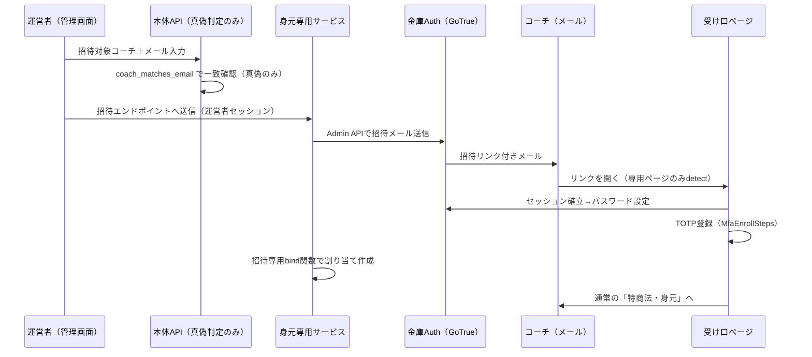

# 金庫アカウント招待リンク方式の設計

対象 Issue：[#810](https://github.com/hinabotaa5-wq/track-talk/issues/810)。
**設計の確定が成果物。プロダクトコードの変更、実コーチへの招待送信、本番設定の変更はしない。**

## 1. 背景・現行形（ベース `f97ad4c` で実物確認済み）

- コーチ側に金庫アカウントの新規登録導線がなく、画面文言は「運営から案内された身元情報専用アカウントでログインしてください」。
- 実コーチ用の発行・割り当て（`identity_vault.members` への subject↔coach_id 登録）を行うコードは repo になく、あるのは合成データ専用の `apps/api/cmd/identityprovision`（合成メール以外をガードで拒否。`internal/identityprovision/email.go`）。
- 金庫のアプリ用ロールは members を読めるだけで、自分で割り当てを作れないのが原則（`deploy/identity-vault/migrations/004_app_role_policies.sql`：members は `FOR SELECT` のみ）。合成用だけ `synthetic_bind` という防御つき関数で例外を作っている（`deploy/identity-vault/migrations/003_synthetic_provision.sql`）。
- 本体側に `identity_boundary.coach_matches_email(コーチID, メール)`（真偽だけを返し、メール自体は返さない）が既にある（`apps/api/migrations/000154_identity_coach_email_match.up.sql`）。
- よって「招待リンク化」は画面変更ではなく、(1) 誰が招待を発行するか、(2) GoTrue Admin API の鍵をどのサービスに置くか、(3) 割り当てをどの経路で作るか、という新しい信頼経路の設計が先に要る。

## 2. 確定方式：運営者発行・身元専用サービス実行・招待専用 bind 関数

Issue §1〜§8 の推奨案はすべて採用する（§2.1〜§2.7・§4 が順に対応）。却下した対抗案は §3 に理由つきで残す。

### 2.1 発行トリガー：運営者の管理画面から（E3）

- `/admin/coaching/identity` で対象コーチを選び、運営者がメールアドレスを入力して招待する。
- 送信前に `coach_matches_email` で本体アカウントのメールと一致することを確かめる。メール値そのものは金庫側に渡さない（真偽のみ）。
- コーチ本人からのリクエスト発行は将来拡張として切り分ける（理由は §3 の却下案 A）。

### 2.2 招待の実行主体と鍵の置き場所：身元専用サービスだけ（E2）

- GoTrue Admin API の招待（inviteUserByEmail 相当）は身元専用サービスだけが行う。Admin API 用の鍵は同サービスの新しい秘密参照として置く。本体 API・Web には置かない。
- 既存の `IDENTITY_AUTH_PUBLIC_KEY`（セッション確認用）とは用途を混同しない。身元専用サービスは現状 Admin 鍵を持たない（`cmd/identityvault/main.go` の環境変数に Admin 鍵は無い。持つのは合成ジョブ `identityprovision` の `IDENTITY_AUTH_ADMIN_KEY` だけ）。
- 前例として、合成ジョブは既に Admin API（`/admin/users` の一覧・作成・削除・パスワード設定）を叩いている（`internal/identityprovision/gotrue.go`）。招待はこの流儀に寄せる。

### 2.3 割り当ての作り方：招待専用の防御つき関数（E2）

- 金庫 migration で招待専用の bind 関数を追加し、アプリ用ロールからの直接 INSERT は引き続き禁止する。
- ガード条件（`synthetic_bind` の型を踏襲する）：
  - 対象 subject が金庫 Auth に実在し、そのメールが招待先と一致する
  - 招待で作られたユーザーである（招待経路の標識。合成の `+synthetic` 標識に相当する実運用の標識を migration で定義する）
  - admin 行ではない（`is_admin` は false 固定。管理者行は作らない・変えない・消さない）
  - subject とコーチのどちらにも既存の割り当てがない
  - 冪等性：同じ招待の再実行で二重に作らない（存在すれば `exists` 相当を返し、何も書かない）
- 手作業で作られた既存アカウントは当面そのまま動かす。新規発行だけを招待経路に寄せ、既存行への付け替えは自動でしない（`synthetic_bind` が付け替えを拒否するのと同じ理由）。

### 2.4 招待リンクの受け口：専用ページでのみ detect（E3）

- 飛び先（例：`/coach/commerce/setup`）の専用ページでのみ金庫クライアントの `detectSessionInUrl` を有効にする。現在の `IdentitySession` は `detectSessionInUrl: false` のままで、受け口ページだけが例外。
- 受け口の流れ：セッション確立 → 本人がパスワードを設定 → TOTP 登録（QR 表示は #749／#753 で実装済みの `MfaEnrollSteps` を使う）→ 通常の「特商法・身元」へ進む。
- リンク内トークンを URL・ログ・ストレージに残さない処理を E3 の受け入れに含める（#808 の sessionStorage 方針と同一：保存は同一タブの sessionStorage のみ）。
- 期限切れ・使用済みリンクの表示を設計に含める。具体的な有効期限と再送可否は §2.5 が未確定のため、文言は「運営者に再送を依頼してください」への誘導に倒す。

### 2.5 再送・失効：未確定（検証計画つき）

- **未確定**：現在の Supabase の仕様で招待の再送ができるかは未確認。再送不可の場合はパスワード再設定リンクで代替できるかも未確認。
- 検証計画（いずれも運営者承認を得てから。承認なしに合成ユーザーでの検証も行わない）：
  1. 公式仕様で招待 API の再送・期限・使用済み後の挙動を確認する
  2. 合成ユーザーで発行→期限切れ→再送→使用済み再利用の各経路を通し、振る舞いを記録する
  3. 結果を本メモに追記し、E3 の画面文言と運用手順に反映する
- 未確認のまま「再送できる」とは書かない。再送可否が確定するまで、運用は「運営者が招待し直す」で回す。

### 2.6 監査と運用

- 誰が・いつ・どのコーチへ招待したかは、メールアドレス自体を残さずに記録する。既存 `access_log`（coach_id・viewer・purpose。メール列なし。`admin.go`）の流用を第一候補とし、招待イベント用の purpose 値（例：`identity_invite`）を E2 で足す。メール本文・リンクは記録しない。
- 失敗時の切り分け手順：発行側（Admin API 応答・鍵・Redirect 設定）、受信側（メール到達・迷惑メール・期限切れ）、受け口側（セッション確立・パスワード要件・TOTP）の3層で切り分ける。詳細手順は E2・E3 の実装 Issue に書く。
- コーチをやめた時の既存の終了・削除経路（coach-end／cleanup）と整合させる。招待済み・未使用の招待は終了時に無効化の対象に含める（具体的な消し方は E2 の設計に書く）。

### 2.7 Supabase Auth 側の設定変更一覧（実装段階で運営者承認を得て行う。本設計では変更しない）

- 招待メールテンプレート（日本語文面・差出人・運営者連絡先）
- Site URL／Redirect URLs の許可リスト（受け口ページの URL を含める）
- パスワード要件（受け口の入力検証と一致させる）
- サインアップ可否の現行設定の確認（招待リンク経由以外の新規登録を許すかどうか）
- いずれも現状確認は名前と用途の範囲で行い、値の読み取り・表示はしない。

## 3. 却下した案と理由

| 案 | 内容 | 却下理由 |
|---|---|---|
| A | コーチ本人が招待をリクエストする | 本人確認の起点が無い状態で新規信頼経路を作ることになり、攻撃面が広がる。既存の管理者境界と真偽チェックをそのまま使える運営者発行に劣る。将来拡張として残す |
| B | 本体 API が招待を実行し、Admin 鍵を本体に置く | 公開 API サービスに金庫 Auth の Admin 鍵を広げる。鍵の置き場所は身元専用サービスに限定する原則（§2.2）に反する |
| C | アプリ用ロールに members への INSERT を直接許可する | 「アプリは自分で割り当てを作れない」原則を壊す。防御つきの SECURITY DEFINER 関数経由に劣る |
| D | 既存 `identityprovision` の合成流を実コーチに流用する | 合成ガード（`+synthetic` 標識・承認済み一致など）が実メールを拒否する前提で作られている。実運用は招待専用の関数を新設する |
| E | 運営者がパスワードを初期設定し、口頭・別経路で伝える | 監査可能なリンクが残らず、パスワードの取り扱いリスクが高い。招待メール経由に劣る |

## 4. 実装 Issue への分割案

### E2：金庫 migration＋招待エンドポイント

- 範囲：招待専用 bind 関数の migration 1件、身元専用サービスの招待エンドポイント（運営者認可・`coach_matches_email` 連携・Admin API 呼び出し・監査記録）、新しい秘密参照の追加（値は扱わない）。
- 前提チェック：ベースの `synthetic_bind`・`coach_matches_email`・members 読み取り専用の形が §1 のとおりであること。食い違えば停止して報告。
- テスト観点：ガード条件の全否定分岐（非実在 subject・メール不一致・admin 行・二重割り当て・付け替え拒否）、冪等性、未知項目・confirm 偽の拒否、他コーチ対象外、平文メール・リンクのログ非出力、既存の個別承認・公開経路の不変。

### E3：受け口ページ＋管理画面の招待ボタン

- 範囲：受け口ページ（例：`/coach/commerce/setup`。当該ページでのみ `detectSessionInUrl` を有効化）、管理画面の招待ボタン（メール入力・一致確認・送信・再送誘導）、期限切れ・使用済みリンクの表示、TOTP 登録への接続。
- 前提チェック：`IdentitySession` の `detectSessionInUrl: false` が保たれていること、#808 の sessionStorage 方針が守られること。食い違えば停止して報告。
- テスト観点：招待リンクでのセッション確立・パスワード設定・TOTP 登録・通常画面への遷移、トークンの URL・ログ・ストレージ残留なし、期限切れ・使用済みの表示、再送可否が未確定の間の文言（再送依頼への誘導）。

## 5. 未確定事項（実装可能であるかのように書かない）

- 招待の再送可否と期限・使用済み後の挙動（§2.5 の検証計画で確定させる）
- 既存の手作業アカウントの棚卸し（件数と作り方の特定は運営者確認が必要）
- 招待メールテンプレートの到達性（迷惑メール判定を含む実送確認は運営者承認後に行う）
- 招待済み・未使用の招待の終了時無効化の具体的な消し方（E2 の設計で決める）
